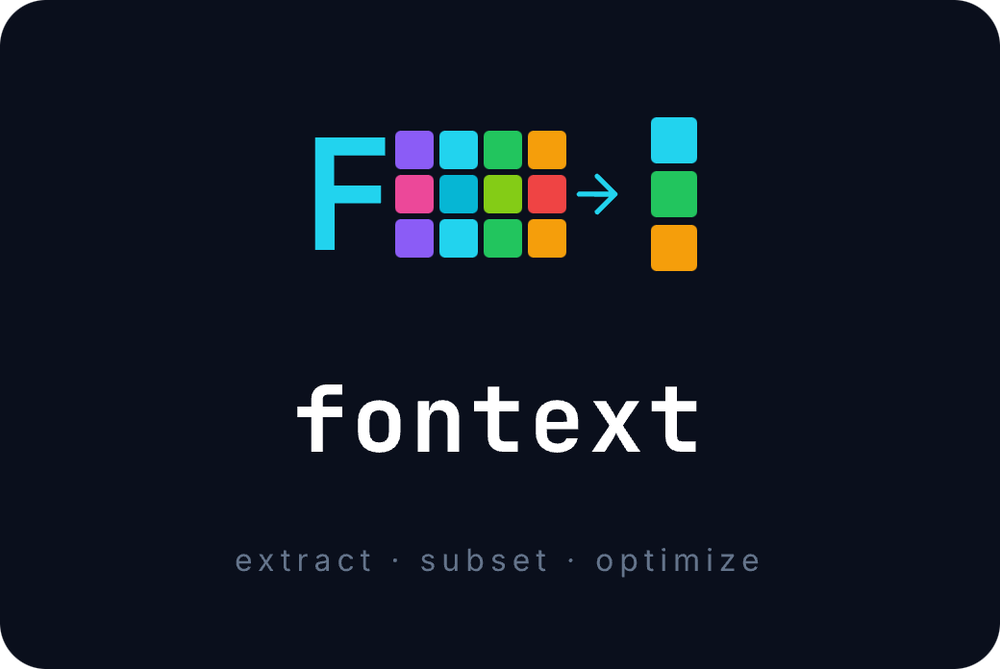

<p align="center">
  
</p>

<p align="center">
  <a href="https://www.npmjs.com/package/fontext"></a>
  <a href="./LICENSE"></a>
  <a href="./package.json"></a>
  <a href="https://codecov.io/gh/a3mitskevich/fontext"></a>
</p>

Extract glyphs from fonts and generate optimized, minimal font files.

Two engines for different use cases:

- **Icon engine** — extract glyphs from ligature-based icon fonts (Material Icons, etc.)
- **Subset engine** — subset any font by characters, unicode ranges or ligatures, preserving kerning and OpenType
  features

## Why Fontext?

Icon fonts often contain 1000+ glyphs. Text fonts ship entire alphabets when you only need a subset. Fontext solves
both:

- **Extract by ligature** — pass ligature names like `"home"`, `"search"`, `"menu"` (icon engine)
- **Extract by raw unicode** — pass the actual unicode character and Fontext resolves the ligature automatically (icon
  engine)
- **Subset by characters** — pass `"ABCabc0123"` to keep only those characters (subset engine)
- **Subset by unicode range** — pass `U+0400-U+04FF` for Cyrillic block (both engines)
- **Subset by ligature** — pass `"home"` to keep that icon of a ligature icon font with every OpenType table (subset
  engine); only the requested ligatures form, not the others their letters could spell
- **Multiple output formats** — SVG, TTF, WOFF, WOFF2, EOT
- **Preserves font features** — subset engine keeps kerning, hinting, GSUB/GPOS via HarfBuzz; pairs of a legacy
  `kern` table are kept only for the glyphs that stay in the font, and `warnings` tells when some of it can't be kept
- **Glyph metadata** — get name, unicode mappings, and SVG path data for each extracted glyph
- **Reproducible output** — identical input produces byte-identical fonts, so content-hashed asset names stay stable
  between builds
- **Presets** — `preset: "web-font"` or `"outline-render"` trims hinting, layout features and names for fonts browsers
  rasterize or for runtimes that draw the outlines themselves; each table can be dropped or kept, and the report lists
  the size of every table (see [Presets and optimization options](#presets-and-optimization-options))
- **Variable fonts** — pin or narrow axes such as `wght` and name the instance after its weight (see
  [Variable fonts](#variable-fonts))
- **Coverage** — find the characters of a text a font lacks before subsetting it, and a warning when a subset misses
  some

## Installation

```bash
npm install fontext
```

Requires Node.js 22.13 or later. The package is ESM only; CommonJS code can still load it with
`require("fontext")`, which Node supports for ES modules since 22.13 without warnings.

## CLI

```bash
npx fontext -i material-icons.woff2 -n my-icons -l home,search,menu -f woff2,ttf -o ./fonts
```

| Flag                                | Description                                                    |
| ----------------------------------- | -------------------------------------------------------------- |
| `-i, --input`                       | Path to the font file (required)                               |
| `-n, --font-name`                   | Name for the output font (required)                            |
| `-l, --ligatures`                   | Comma-separated ligature names                                 |
| `-r, --raws`                        | Comma-separated raw unicode characters                         |
| `-u, --unicode-ranges`              | Comma-separated unicode ranges (e.g. `U+E000-U+E100`)          |
| `-f, --formats`                     | Output formats: `svg,ttf,woff,woff2,eot` (default: all)        |
| `-o, --output`                      | Output directory (default: `.`)                                |
| `--preset`                          | `web-font` or `outline-render`                                 |
| `--no-hinting`                      | Drop TrueType hinting and `gasp` (`--hinting` keeps them)      |
| `--layout-features`                 | `all`, `default` or tags: `liga,kern`                          |
| `--name-ids`                        | Name ids to keep: `1,2,4`                                      |
| `--name-languages`                  | Name record languages to keep: `all` or `0x409,0x419`          |
| `--drop-tables`                     | Tables to drop: `MATH,DSIG`                                    |
| `--keep-tables`                     | Tables to keep that would be dropped: `gasp,meta,PCLT`         |
| `--glyph-names`                     | Keep glyph names in `post`                                     |
| `--desubroutinize`                  | Inline CFF subroutines (`--no-desubroutinize` keeps them)      |
| `--axes`                            | Pin or narrow variation axes: `wght=700,wdth=75:100,*=default` |
| `--rename`                          | Name the font after its pinned weight (`Bold` for `wght=700`)  |
| `--rename-family`, `--rename-style` | New family and style names                                     |
| `--split scripts`                   | Also write a font per script: `<font-name>.<script>.<format>`  |

`.fontextrc.json` and its batch entries take the same options as `preset`, `hinting`, `layoutFeatures`,
`nameIds`, `nameLanguages`, `dropTables`, `keepTables`, `glyphNames`, `desubroutinize`, `axes`
(`{ "wght": 700, "wdth": { "min": 75, "max": 100 } }`), `rename` (`true` or `{ "family", "style" }`) and `split`.
The output lists the tables the font lost and the axes of a variable font; `--json` has the whole table and axes
report. `fontext --help` lists every flag.

## Quick Start

```javascript
import { extract } from "fontext";
import fs from "fs";

const font = fs.readFileSync("material-icons.woff2");

const result = await extract(font, {
  fontName: "my-icons",
  ligatures: ["home", "search", "menu"],
  formats: ["woff2", "ttf"],
});

// result.woff2 — Buffer with optimized WOFF2 font
// result.ttf  — Buffer with optimized TTF font
// result.meta — glyph metadata (name, unicode, svg)

fs.writeFileSync("my-icons.woff2", result.woff2);
```

## API

### `extract(content, options): Promise<ExtractedResult>`

| Parameter | Type                                  | Description                                 |
| --------- | ------------------------------------- | ------------------------------------------- |
| `content` | `Buffer \| Uint8Array \| ArrayBuffer` | Font file contents: TTF, OTF, WOFF or WOFF2 |
| `options` | `MinifyOption`                        | Extraction configuration (see below)        |

### `MinifyOption`

| Field            | Type             | Default                | Description                                                                                                                                                            |
| ---------------- | ---------------- | ---------------------- | ---------------------------------------------------------------------------------------------------------------------------------------------------------------------- |
| `fontName`       | `string`         | —                      | **Required.** Name for the output font                                                                                                                                 |
| `ligatures`      | `string[]`       | `[]`                   | Ligature strings to extract (e.g. `['home', 'search']`); the subset engine keeps each with its letters, and characters and unicode ranges keep the ligatures they form |
| `raws`           | `string[]`       | `[]`                   | Raw unicode characters — Fontext will resolve their ligatures automatically                                                                                            |
| `unicodeRanges`  | `string[]`       | `[]`                   | Unicode ranges to extract (e.g. `['U+E000-U+E100', 'U+F000']`)                                                                                                         |
| `characters`     | `string`         | —                      | Characters to keep (e.g. `'ABCabc0123'`) — subset engine only                                                                                                          |
| `engine`         | `Engine`         | `'icon'`               | `'icon'` for ligature fonts, `'subset'` for text fonts (preserves kerning), `'convert'` to change format only                                                          |
| `formats`        | `Formats[]`      | all formats            | Output formats: `'svg'`, `'ttf'`, `'woff'`, `'woff2'`, `'eot'`; the subset engine defaults to TTF, WOFF and WOFF2                                                      |
| `safariFix`      | `boolean`        | `false`                | Patch OS/2 and hhea metrics for Safari                                                                                                                                 |
| `preset`         | `Preset`         | —                      | `'web-font'` or `'outline-render'`, see [Presets and optimization options](#presets-and-optimization-options)                                                          |
| `hinting`        | `boolean`        | `true`                 | Keep TrueType hinting and `gasp` — subset and convert engines                                                                                                          |
| `layoutFeatures` | `LayoutFeatures` | `'all'`                | `'all'`, `'default'` (HarfBuzz's default set) or feature tags — subset and convert engines                                                                             |
| `nameIds`        | `number[]`       | 0–6 (icon: 1, 2, 4, 6) | Name ids to keep                                                                                                                                                       |
| `nameLanguages`  | `NameLanguages`  | `[0x409]`              | `'all'` or the language ids of the name records to keep — subset and convert engines                                                                                   |
| `dropTables`     | `string[]`       | `[]`                   | Tags of tables to drop                                                                                                                                                 |
| `keepTables`     | `string[]`       | `[]`                   | Tables to keep that would be dropped: `gasp`, `meta`, `PCLT` — subset and convert engines                                                                              |
| `glyphNames`     | `boolean`        | `false`                | Keep the glyph names (`post` format 2)                                                                                                                                 |
| `desubroutinize` | `boolean`        | `false`                | Inline CFF subroutines — subset and convert engines                                                                                                                    |
| `axes`           | `Axes`           | —                      | Pin (`{ wght: 700 }`, `"default"`, `"*": "default"` for the rest) or narrow (`{ wght: { min: 600, max: 700 } }`) variation axes, see [Variable fonts](#variable-fonts) |
| `rename`         | `Rename`         | —                      | `true` or `{ family?, style? }`: rewrite the family and style names, see [Variable fonts](#variable-fonts)                                                             |
| `transform`      | `FontTransform`  | —                      | `(ttf: Uint8Array, context?: { script }) => Uint8Array \| Promise<Uint8Array>`, rewrites the final TTF before encoding                                                 |
| `split`          | `Split`          | —                      | `'scripts'`: also a font per Unicode script in `chunks`, see [Splitting by script](#splitting-by-script) — subset and convert engines                                  |

> At least one of `ligatures`, `raws`, `unicodeRanges`, or `characters` must be provided.

### Error Handling

`extract()` returns a rejected promise, never a synchronous throw, in the following cases:

- Font input is not a `Buffer`, `Uint8Array` or `ArrayBuffer` — `TypeError: "Font input must be a Buffer, Uint8Array or ArrayBuffer"`
- Font data is not TTF, OTF, WOFF or WOFF2 — `"Unsupported font format: ..."`
- Font is a collection (TTC, DFONT) — `"Font collections (TTC/DFONT) are not supported. Provide a single font file."`
- Font tables are damaged, or the file is cut short so that a table needed to read glyphs runs past its end — `"Malformed GSUB table: ..."`, `"Malformed glyf table: ..."`, `"Malformed WOFF file: ..."` and similar, naming the table and offset
- Missing `fontName` — `"fontName is required"`
- No glyph selection for the icon or subset engine —
  `"At least one of ligatures, raws, unicodeRanges, or characters must be provided"`
- Empty or unknown `formats` — `"At least one output format must be specified"` / `"Invalid format(s): ..."`
- Font lacks a GSUB ligature lookup table (required for `raws`) — `"Font does not contain a GSUB ligature lookup table"`
- A raw unicode character has no matching ligature, or an icon engine ligature doesn't form a single glyph (an
  unknown name or a typo would otherwise give the glyphs of its letters) — `"Font does not contain a ligature for \"...\""`
- The icon engine selection matches no glyph, e.g. unicode ranges the font maps none of —
  `"No glyphs match the selection: the font maps none of unicodeRanges ..."`
- An unknown `preset`, a `hinting`, `glyphNames` or `desubroutinize` that is not a boolean, a `layoutFeatures`
  keyword other than `all` / `default`, a name id that is not an integer from 0 to 32767, a name language that is
  not an integer from 0 to 65535, or a tag that is not 1–4 printable ASCII characters — `"Invalid preset: ..."`,
  `"Invalid name id(s): ..."`, `"Invalid tag(s) in dropTables: ..."` and similar; a `dropTables` tag of a table
  every font needs — `"Invalid tag(s) in dropTables: \"head\". The font needs these tables: ..."`; a `keepTables`
  tag other than `gasp`, `meta` and `PCLT`, or one also in `dropTables` — `"Invalid tag(s) in keepTables: ..."`,
  `"keepTables and dropTables both name: ..."`
- `axes` that are not an object of numbers, `"default"` and `{ min, max }` — `"Invalid value for axis \"wght\": ..."`;
  `"*"` with anything but `"default"` — `"Invalid value for axes[\"*\"]: ..."`; a range in
  the icon engine — `"The icon engine builds a static font: pin axis \"wght\" to one value"`; a static font —
  `"axes is set, but the font has no variation axes"`; an axis the font lacks — `"Unknown axis \"opsz\". The font
has: wght 100-900, ..."`; a value outside the axis — `"Axis \"wght\" value 950 is outside the font's range
100-900"` (HarfBuzz would clamp it silently)
- A `rename` that is neither `true` nor `{ family?, style? }` with non-empty strings — `"rename must be true or an
object with family and/or style"`; `rename: true` without a pinned `wght` — `"rename: true takes the style from a
pinned wght axis: ..."`, a `wght` range without `rename.style` — `"rename takes the style from a pinned wght axis, and
wght is a range: set rename.style"`; a pinned weight without a usual name — `"Cannot name weight 650: set rename.style"`; a
  family without a character a PostScript name allows — `"rename gives an empty PostScript name: ..."`
- The subset engine keeps `ligatures` the source forms, but the `layoutFeatures` left out the feature that forms
  them — `"Ligatures do not form with these layoutFeatures: \"home\"; they need the GSUB feature(s) rlig, which the
subset left out. ..."` (Material Icons forms its ligatures with `rlig`, not `liga`)
- A `split` other than `'scripts'` — `"Invalid split: ..."`; `split` with the icon engine — `"split is not supported by
the icon engine: ..."`; a subset `ligatures` text whose letters belong to two scripts (Common letters such as `_` and
  digits aside) — `"Ligature \"...\" mixes the scripts latin and greek, ..."`: split fonts can't form it
- `transform` throws or rejects — `"transform failed: ..."` with the original error as `cause`; it returns WOFF,
  WOFF2, a collection or no font — `"transform must return an uncompressed TrueType or OpenType font, not WOFF2"` and
  similar

### `ExtractedResult`

An object with optional keys for each requested format (`svg`, `ttf`, `woff`, `woff2`, `eot`), each containing a
`Buffer`. Also includes `meta`, `report` and `warnings`, and with `split` the `chunks` (see
[Splitting by script](#splitting-by-script)):

```typescript
interface GlyphMeta {
  name: string; // ligature name
  unicode: string[]; // unicode mappings
  svg: string; // SVG markup for the glyph
}

interface OptimizationReport {
  originalSize: number; // input font size in bytes
  formats: {
    [format: string]: {
      size: number; // output size in bytes
      saving: number; // percentage saved, negative when the output is larger
    };
  };
  // The tables of the input (decompressed, before instancing) and of the TTF every binary format was
  // encoded from, with their sizes in bytes; no tables when only SVG was built
  tables?: {
    input: Record<string, number>; // { cmap: 808, cvt: 496, glyf: 37826, ... }
    output: Record<string, number>;
    dropped: string[]; // tags of the input the output lacks, sorted
  };
  // What became of the axes of a variable input, in the units of each axis; none for a static input or
  // when only SVG was built
  axes?: {
    pinned: Record<string, number>; // axes the output no longer varies along: { wght: 700 }
    variable: { tag: string; min: number; default: number; max: number }[]; // axes it still has
  };
}

interface FontWarning {
  code: "legacy-kern" | "missing-characters" | "unpinned-axes"; // what the output could not keep
  message: string;
}
```

Table tags lose their trailing spaces (`"cvt"`, `"CFF"`), the form `dropTables` and `keepTables` take.

`warnings` lists what the subset and convert engines could not keep from the source font; the CLI prints them
(and puts them in `--json` output). `legacy-kern`: the font kerns only in the legacy `kern` table, and part of it was
left out — an Apple or malformed table, format 2/3, cross-stream or vertical subtables, or pairs of glyphs without a
code point that could not be matched in the subset. A version of the font with kerning in GPOS avoids it.
`missing-characters`: the source has no glyph for some `characters` of the subset engine, named by code point
(`U+0416 "Ж", U+000A`, up to 20). Joiners and variation selectors (default ignorable code points) don't count,
shaping hides them; control characters do, so strip line feeds from texts you pass, e.g.
`text.replace(/\p{Cc}/gu, "")`. Unicode ranges don't warn: they cover whatever the font has. `unpinned-axes`: `axes`
pins every axis it names, but the font has others, so the output stays variable along them (`fvar`, `gvar` and the
other variation tables stay, often doubling the size); `"*": "default"` pins them.

### Icon engine output

The icon engine builds a new font from the extracted glyphs. Each glyph is scaled so that its vertical advance fills
the em, which is the source font's units per em: a glyph as tall as the em keeps its coordinates. An em below 512
units is multiplied up to at least 512, since outlines are rounded to whole units, and an em at which a very wide glyph
would overflow TrueType coordinates is lowered. Ligatures are `liga` ligatures under the `DFLT` and `latn` scripts. The
font keeps only the family, subfamily, full and PostScript names (Windows, English) and has no glyph names in its
`post` table unless `glyphNames` is set: `meta` gives the name of each glyph.

### Presets and optimization options

A font is either rasterized by the system, as browsers do, or drawn by a runtime from its outlines as vector paths,
SDF or PDF, with HarfBuzz shaping: canvas and WebGL text (three.js `TTFLoader`, opentype.js, troika-three-text),
animation runtimes such as Rive, PDF generators. Outline renderers use no hinting. `preset` picks defaults for
either:

| `preset`           | Hinting             | Layout features  | Name ids               | CFF             |
| ------------------ | ------------------- | ---------------- | ---------------------- | --------------- |
| none               | kept                | all              | 0–6 (icon: 1, 2, 4, 6) | kept as is      |
| `'web-font'`       | kept                | HarfBuzz default | 1, 2, 4, 6             | desubroutinized |
| `'outline-render'` | dropped, `gasp` too | HarfBuzz default | 1, 2, 4, 6             | kept as is      |

A preset doesn't choose the formats: pair it with `formats`, e.g. `['woff2']` for the web and `['ttf']` for most
outline renderers (troika reads no WOFF2, Rive only TTF and OTF). Explicit options override the preset. Without a
preset and these options the output is what it was before they existed. Every preset keeps the legacy `kern` pairs
and the layout tables that shape text, `GSUB`, `GPOS` and `GDEF`.

- **Hinting** is most of a hinted TrueType font: Latin and Cyrillic of Liberation Sans take 53 840 → 20 496 bytes as
  TTF (WOFF2 32 272 → 11 224), DejaVu 38 832 → 22 256. `hinting: false` drops `fpgm`, `prep`, `cvt `, `hdmx`,
  `VDMX`, `gasp` (which HarfBuzz would keep) and the glyph instructions; outlines stay the same. HarfBuzz drops
  `LTSH` either way.
- **Layout features**: HarfBuzz's default set (`liga`, `rlig`, `calt`, `kern`, `mark`, script features and so on)
  is what troika, opentype.js and Rive apply, and browsers apply it unless CSS asks for more. Dropping the other
  features takes DejaVu's WOFF2 9 984 → 8 892 bytes. Glyphs only an optional feature such as `dlig` reaches are
  left out too. A subset by `ligatures` is rejected when the listed features no longer form a ligature the source
  forms, naming the feature it needs.
- **Names**: ids 1, 2, 4 and 6 are family, subfamily, full name (three.js `TTFLoader` reads it) and PostScript name;
  the rest saves a few hundred bytes. Only English (United States) records stay unless `nameLanguages` lists other
  language ids or is `'all'`: Arial's `name` table grows 762 → 1 904 bytes with every language. HarfBuzz keeps the
  names `fvar` and `STAT` refer to.
- **Glyph names**: `post` is format 3, without glyph names, in every engine; `glyphNames: true` keeps them (format 2),
  e.g. for PDF text extraction.
- **CFF desubroutinization** inlines the subroutines: smaller once compressed, larger raw. Measured on four CFF fonts,
  Latin to the whole font:

  | Font, glyphs           | raw OTF | WOFF  | WOFF2 | brotli |
  | ---------------------- | ------- | ----- | ----- | ------ |
  | Nimbus Sans, Latin     | +1.2%   | −5.6% | −6.5% | −5.6%  |
  | Nimbus Sans, whole     | +22.5%  | −2.4% | −2.9% | −3.3%  |
  | P052 Bold, Latin       | +5.3%   | −6.8% | −7.9% | −7.9%  |
  | Source Code Pro, whole | +44.7%  | +4.0% | −1.7% | −2.0%  |

  So `web-font` desubroutinizes and `outline-render` doesn't; `desubroutinize` overrides either. TrueType outlines
  don't change.

- **Tables HarfBuzz drops**: `DSIG` (a signature can't match a changed font), `JSTF`, `LTSH`, `PCLT`, `kern` (fontext
  puts its pairs back) and tables it doesn't know, such as `meta`. `keepTables` copies `meta` and `PCLT` from the
  source, whose data refers to no glyph id, and keeps `gasp` without hinting. Other tables HarfBuzz drops refer to
  glyph ids it can't renumber, so they are rejected.

Tags of `layoutFeatures`, `dropTables` and `keepTables` are 1–4 printable ASCII characters; shorter ones are padded
with spaces, so `"cvt"` is the `cvt ` table. `dropTables` rejects the tables every font needs — those browsers require
(`cmap`, `head`, `hhea`, `hmtx`, `maxp`, `name`, `OS/2`, `post`) and the outlines (`glyf`, `loca`, `CFF`,
`CFF2`). Dropping `kern` also keeps the subset and convert engines from putting the legacy kern pairs back.
`report.tables` shows what each option left: the size of every table and what was dropped.

Per engine: the subset and convert engines take every option. The icon engine takes `preset`, `nameIds`,
`dropTables`, `glyphNames`, `axes`, `rename` and `transform`; its font comes from SVG outlines, so it has no hinting,
one `liga` feature that forms the icons and English names only: `hinting`, `layoutFeatures`, `nameLanguages`,
`keepTables` and `desubroutinize` are checked but ignored. The `svg` format is not affected by any of these options
except `axes`.

`transform` receives the final font once (and once more per chunk with `split`) — after the legacy `kern` table is
restored, the font renamed and the Safari fix applied, before encoding — and what it returns is encoded into every
binary format. It must return an uncompressed TrueType or OpenType font. The subset and convert engines read `meta`
from the transformed font. It is not called when only `svg` is requested:

```javascript
const result = await extract(font, {
  fontName: "roboto-3d",
  engine: "subset",
  characters: "ABCabc0123",
  preset: "outline-render",
  formats: ["ttf"],
  // e.g. run the font through another tool that takes and returns TTF bytes
  transform: async (ttf) => myFontTool(ttf),
});

fs.writeFileSync("roboto-3d.ttf", result.ttf);
```

### Variable fonts

`axes` instances a variable font before anything else, in every engine: a value pins an axis, `{ min, max }` narrows
it, in the units of the axis (`wght` 100–900, `wdth` in percent). A pinned axis leaves `fvar`, `gvar` and the other
variation tables; a font with every axis pinned is static. The outlines, advances, shaping, legacy kern pairs, `meta`
and the SVG font all come from the instance. A narrowed axis keeps the font's default, clamped into the range, so
`wght: { min: 600, max: 700 }` of a font whose default is 400 draws at 600 unless CSS sets `font-weight`. The icon
engine builds a static font, so it takes only values.

`"default"` pins an axis at the font's default, and the key `"*"` with `"default"` pins every axis the others don't
name: `{ wght: 700, "*": "default" }` gives a static Bold of Inter, whose `opsz` would otherwise stay variable. Pinning
some axes and leaving others gives an `unpinned-axes` warning; a range keeps the font variable on purpose and gives none.
`report.axes` lists the pinned axes with their values and
the axes the output still varies along.

An instance at a master of the font (a weight the designer drew, such as the default) has the outlines of the
source. Between masters HarfBuzz interpolates the points and rounds them to whole font units, so an outline may lie up
to one unit (0.1% of a 1000-unit em) from what a renderer interpolating the variable font draws; advances match.

```javascript
const result = await extract(font, {
  fontName: "inter-bold",
  engine: "subset",
  characters: text,
  axes: { wght: 700 },
  rename: true,
  preset: "outline-render",
  formats: ["ttf"],
});
```

HarfBuzz would clamp a value outside an axis silently and ignore an axis the font lacks; fontext rejects both, and
`axes` on a static font. HarfBuzz sets `usWeightClass` and `usWidthClass` of the instance but leaves its names: a
Bold instance is still called Regular. `rename` rewrites them:

- `rename: true` keeps the family of the source and names the style after the pinned weight (`"default"` and `"*"` pin it at the font's default): 100 Thin, 200
  ExtraLight, 300 Light, 400 Regular, 500 Medium, 600 SemiBold, 700 Bold, 800 ExtraBold, 900 Black, with Italic when
  the source is italic or `ital` is pinned to 1. Other weights need `rename.style`.
- `rename: { family, style }` sets either or both, with or without axes; a part left out comes from the source as
  above, so `{ family: 'Brand' }` renames a subset that must not clash with an installed font.
- Regular, Italic, Bold and Bold Italic are written as the four styles of the family (name ids 1 and 2); any other
  style gets a family of its own (`Inter SemiBold`, `Regular`) and the typographic names 16 and 17 (`Inter`,
  `SemiBold`) that group it with the others, also when `nameIds` leaves them out. The full name (4), PostScript name
  (6, `Inter-SemiBold`) and, if the font has it, the unique id (3) follow. The records are Windows English; records
  of these ids in other languages go, and so do the WWS names (21, 22) and the variations PostScript prefix (25),
  which would keep the old family. A narrowed `wght` has no single weight to name the style after: set
  `rename.style`. The bold, italic and regular bits of `OS/2` `fsSelection` and `head`
  `macStyle` match the style.
- Names inside CFF outlines stay: browsers and HarfBuzz read the `name` table, some PDF tools read CFF's own names.

### Characters a font lacks

`findMissingCodePoints(content, text)` lists the code points of a text the font has no glyph for, each once, in the
order they occur — what a subset of the text would lack, before building it. Control characters such as a line feed
are listed too. It reads TTF, OTF, WOFF and WOFF2 and is also in `fontext/browser` (without WOFF2).

```javascript
import { findMissingCodePoints } from "fontext";

const missing = await findMissingCodePoints(font, translations.join(""));
// [0x416, 0x1f600] — "Ж" and "😀"
```

### Splitting by script

`split: 'scripts'` also builds a font per Unicode script of the selection into `result.chunks`, so an app loads the
writing system a text needs and the others on demand: browsers through `@font-face` with `unicode-range`, runtimes
through their fallback fonts (Rive's `setFallbackFontCallback`, troika's fallback fonts). The top-level buffers,
`meta`, `report` and `warnings` stay the unsplit font, as without `split`. The subset engine splits its
characters, unicode ranges and ligature letters (only code points the font maps), convert every code point of the font.
The icon engine rejects `split`.

```typescript
type FontChunk = Partial<Record<Formats, Buffer>> & {
  script: string; // "latin", "cyrillic", "old_italic"...; "unknown" (private use), "common"
  codePoints: number[]; // everything the chunk's font maps
  unicodeRange: string; // "U+0020-007E,U+00A0" — what to load this font for
  meta: GlyphMeta[];
  report: OptimizationReport;
  warnings: FontWarning[];
};
```

- **Common and Inherited code points** — digits, punctuation, space, emoji, combining marks — are in **every** chunk's
  font, so a Cyrillic font draws "12:30, №5" and accents on its own. They are in the `unicodeRange` of one chunk only,
  latin or else the first: a page with a digit loads that one font, not all of them. A selection of Common and
  Inherited code points alone gives one chunk, `"common"`.
- **Unknown**: code points of no script, e.g. private use icons, form a chunk of their own.
- **Ligatures** of the subset engine go to the chunk of their letters' script; Common letters (`_`, digits) don't
  decide it, and a ligature of Common letters only goes into every chunk. A ligature mixing two scripts is rejected:
  its letters would be in different fonts, where it can't form.
- Chunks are ordered by the first code point of their script, and each is a subset of the source with the same
  options: preset, axes, hinting, layout features, names, kept and dropped tables, legacy kern pairs of its glyphs,
  Safari fix.
  Kern pairs across two scripts stay only in the unsplit font. `transform` runs for the unsplit font as before, then
  once per chunk with `{ script }` as its second argument.
- Scripts follow the Unicode version of the Node.js runtime (`\p{Script=…}`); the list covers Unicode 17.

The CLI writes the chunks next to the unsplit font as `<font-name>.<script>.<format>`, and `--json` lists each with
its script, `unicodeRange`, counts and files.

```javascript
const { chunks } = await extract(font, {
  fontName: "noto",
  engine: "subset",
  unicodeRanges: ["U+0000-00FF", "U+0370-03FF", "U+0400-04FF"],
  formats: ["woff2"],
  split: "scripts",
});

const css = chunks.map(({ script, unicodeRange, woff2 }) => {
  fs.writeFileSync(`noto.${script}.woff2`, woff2);
  return `@font-face {
  font-family: "Noto";
  src: url("noto.${script}.woff2") format("woff2");
  unicode-range: ${unicodeRange};
}`;
});
fs.writeFileSync("noto.css", css.join("\n"));
```

In Rive, the chunks of `preset: 'outline-render', formats: ['ttf']` are fallback fonts, looked up by the missing code
point:

```javascript
import { RiveFont, decodeFont } from "@rive-app/webgl2";

// chunks: [{script, codePoints}] saved at build time, next to the chunks' TTF files
const fallbacks = await Promise.all(
  chunks.map(async ({ script, codePoints }) => {
    const bytes = await fetch(`/fonts/noto.${script}.ttf`).then((res) => res.arrayBuffer());
    return { codePoints: new Set(codePoints), font: await decodeFont(new Uint8Array(bytes)) };
  }),
);

// Before Rive starts rendering
RiveFont.setFallbackFontCallback((codePoint) =>
  fallbacks.filter(({ codePoints }) => codePoints.has(codePoint)).map(({ font }) => font),
);
```

## Supported Input Formats

Single TrueType and OpenType fonts (TTF, OTF with CFF outlines), WOFF and WOFF2. Fonts are read with
[HarfBuzz](https://github.com/harfbuzz/harfbuzzjs), which also lays out the ligatures. Font collections (TTC, DFONT)
are not supported.

## Browser Usage (experimental)

A browser entry point finds glyphs and their SVG outlines without Node.js APIs or format conversion. It reads TTF, OTF
and WOFF; WOFF2 is rejected with an error, so decode it first or use the Node entry, which reads WOFF2.

```javascript
import {
  createFont,
  findMetaByLigatures,
  findLigaturesByRaws,
  findMissingCodePoints,
} from "fontext/browser";

const response = await fetch("/fonts/icons.woff");
const data = new Uint8Array(await response.arrayBuffer());

const font = await createFont(data);
const meta = findMetaByLigatures(font, ["home", "search"]);
// meta[0].svg — SVG markup for the glyph
const ligatures = await findLigaturesByRaws(data, ["\uE88A"]);
const missing = await findMissingCodePoints(data, "home"); // [] — Material Icons maps the letters
```

`Font.axes` lists the variation axes of a variable font: `{ tag, min, default, max }`.

`findMetaByLigatures()` returns the glyphs the text is laid out to: a text that forms no ligature gives the glyphs of
its letters. `extract()` rejects such ligatures instead.

HarfBuzz runs as WebAssembly (`harfbuzz.wasm`, about 430 KB, 180 KB gzipped). It is loaded on the first
`createFont()` call from a URL relative to the module (`new URL(..., import.meta.url)`), and the module uses top-level
await, so the bundler has to keep both:

- **Vite** works with the default config. In a Web Worker set `worker: { format: 'es' }`.
- **webpack 5** needs `resolve: { fallback: { module: false } }`.
- A Content Security Policy must allow `'wasm-unsafe-eval'` in `script-src`, and `.wasm` files must be served as
  `application/wasm`.

## Development

`npm test` runs the Vitest suite. The browser checks render the output of every engine and format and compare it
with the source font pixel by pixel, one browser per script:

- `npm run test:e2e:safari` — the installed Safari, through `safaridriver`. Once per Mac: Safari > Settings >
  Advanced > "Show features for web developers", then Settings > Developer > "Allow remote automation".
- `npm run test:e2e:chrome` — the installed Google Chrome, through Playwright.
- `npm run test:e2e:firefox` — Playwright's Firefox; run `npx playwright install firefox` once.

`npm run test:e2e:manual` serves the same checks at http://localhost:4178 to open in any browser.

## License

[MIT](./LICENSE)
